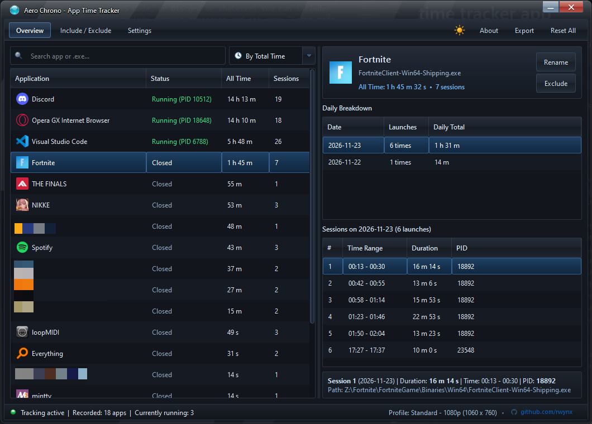
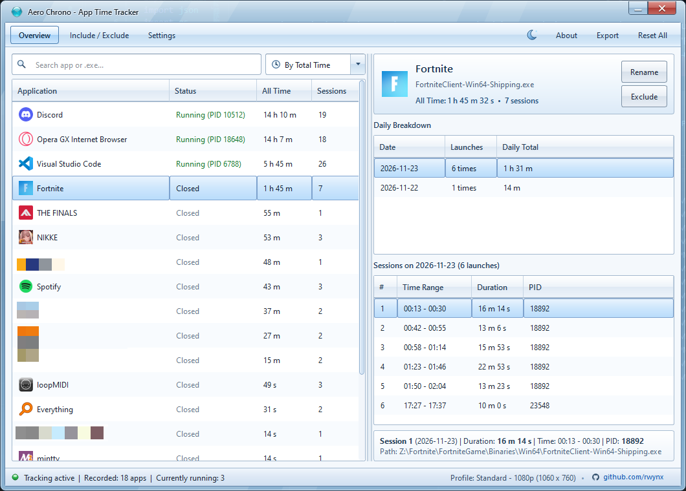

# Aero Chrono - App Time Tracker

Aero Chrono is a simple time tracker app. You can check how much time you spend on certain stuff, let's say VS Code, Spotify, Firefox, Discord or whatever! You can include/exclude certain processes and set some "Focus mode only" if you like, so they won't be tracked unless you are on that screen! Everything saved in a local SQLite database. 

Also it's safe, uses very low level APIs like `OpenProcess PROCESS_QUERY_LIMITED_INFORMATION` or `QueryFullProcessImageNameW` to know which is which, the path etc. and `EVENT_SYSTEM_FOREGROUND` to know which window is active (mainly for **Focus Only** mode).

> Many BS Windows processes, system & background things, overlays, peripheral apps and anti-cheat processes automatically excluded, you can see the full list of [default excluded stuff here](DEFAULT_EXCLUDED_APPS.MD). You can `include` them any time in Chrono settings.

---
<br>
<p align="center" style="display: flex; justify-content: center; align-items: center; gap: 30px;">
  &nbsp;&nbsp;
  
</p>

<p align="center"><i>Dark & Light Modes based on Vista Obsidian and Windows 7 Aero.</i></p>

## Key Features

- **Automatic Activity Tracking**: Starts when you boot up, monitors running and foreground applications.
- **Focus-Only Mode**: Option to track specific applications only when their window is active and in focus. Otherwise Chrono tracks *everything*.
- **Details**: View daily breakdowns, total usage, and individual session timestamps.
- **Classic Windows Feel**: Windows 7 Aero Light & Vista Obsidian Dark Glass themes. Basically light mode/dark mode.
- **Private**: Fully offline, storing data locally in a SQLite database with JSON/CSV export capabilities. Do whatever you want with it! *Maybe I should add Drive connection or something...*
- **Always Working**: You launch it, set it to "Auto start", it always runs in the background and never uses more than %0.1~ RAM (50~ MB), close it and it stays in your system tray.

> [!TIP]
> DB file lives in `%APPDATA%`, but you can turn it into a portable version by adding a `portable.txt` file in the same folder as the `.exe` file. It will include the `data` folder right there after you restart the app. But it will, of course, start counting from zero, it won't move the initially created db. If you want a full migration with your existing DB when you change PCs or something, just back it up first.

---
## Requirements

- Windows 10 or 11 - *for now at least*
- Python 3.10+
- Dependencies: `pip install -r requirements.txt`
---
## Wanna do it yourself?

Run from the source:
```powershell
python AeroChrono.py
```
Build it to an exe yourself:
```powershell
pyinstaller AeroChrono.spec --noconfirm
```
---
## Credits

- **App Icon**: Created by Rei (goated woman feeding on frutiger aero)
- Help from Gemini to implement the Obsidian theme and the dark, stylized scroll bar.
